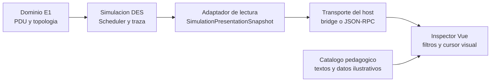

# Propuesta de arquitectura: motor headless e inspector Vue

Estado: propuesta para aprobar; no se implementa integracion en esta fase.

## Limites



- Dominio y scheduler no conocen Vue, JSON de UI, texto localizado ni layout.
- El adaptador lee tipos semanticos del motor y los convierte a un DTO
  versionado. Es el unico lugar que conoce ambos lados.
- La UI conserva su cursor visual y sus filtros inmutables; navegar hacia atras
  nunca rebobina el scheduler ni altera `VirtualTime`.
- El catalogo pedagogico transforma codigos semanticos en texto y puede marcar
  informacion como ilustrativa. No esta en el motor.

## Contrato propuesto

No sustituye a ADR-0002 ni altera `ScenarioCanonicalReport`.

```json
{
  "schema_version": "presentation/v1",
  "scenario_id": "E1-S2",
  "run_label": "cold",
  "topology": {
    "nodes": [{"id": "pc1", "kind": "host"}],
    "interfaces": [{"id": "pc1:eth0", "device_id": "pc1", "name": "eth0"}],
    "links": [{"id": "link1", "a": "pc1:eth0", "b": "sw1:port1"}]
  },
  "execution": {"final_virtual_time_ns": "8700", "outcome": "Quiescent"},
  "trace_retention": {"total_emitted_ever": "27", "dropped_by_capacity": "0"},
  "events": [{
    "trace_seq": "1",
    "at_ns": "0",
    "kind": "arp_packet_queued",
    "actor": {"device_id": "pc1", "interface_name": "eth0"},
    "ingress": null,
    "egress": null,
    "protocols": ["arp", "icmp"],
    "inbound_pdu": null,
    "outbound_pdu": null,
    "table_delta": null,
    "decision_code": "arp_packet_queued",
    "caused_by": null
  }]
}
```

Campos de tiempo, secuencia, contadores y IDs potencialmente crecientes se
transportan como cadenas decimales. El formato canonico mantiene sus numeros
JSON como ADR-0002 ya fija; la eleccion solo protege al consumidor JavaScript
frente a limites futuros de `number`.

Los tipos de PDU seran objetos estructurados equivalentes a los modelos E1,
con un discriminante de payload. `decision_code` sera un codigo estable como
`arp_target_ip_mismatch`, `mac_learned` o `ping_completed`, no una frase. En
v1, `caused_by` puede ser `null`: no se infiere causalidad que el motor no
emite. Una evolucion posterior puede introducir `command_id` y
`caused_by_trace_seq` en la instrumentacion del motor.

`topology` contiene identificadores reales, no posiciones. El cliente posee
un `TopologyPresentation` separado para x/y, iconos y nombres didacticos. La
misma separacion aplica a checksums, longitudes y textos explicativos: deben
marcarse `illustrative`, nunca presentarse como salida nativa E1.

## Alternativas de transporte

| Alternativa | Ventajas | Costes/riesgos | Distribucion y pruebas |
| --- | --- | --- | --- |
| Host Vue con bridge en proceso hacia Rust | Sin proceso adicional; tipado/DTO inmediato; candidato natural si se elige Tauri. | Ata la eleccion del motor y host; exige frontera async y serializacion cuidadosa. | Un paquete desktop; tests de contrato del adaptador y bridge. |
| Sidecar JSON-RPC por stdin/stdout | Neutral entre Rust y C#; aísla el motor; el protocolo se prueba como caja negra. | Ciclo de vida, versionado, errores de proceso, backpressure y empaquetado de dos binarios. | Excelente para conservar ambas alternativas; mas complejidad operativa. |
| HTTP/WebSocket local | Comodo para desarrollo e inspeccion manual de eventos. | Puertos, seguridad local, firewall, reconexion y mas superficie de fallo. | No recomendado para la primera integracion desktop. |
| Host .NET con WebView que carga Vue | C# en proceso; buena ruta si se prioriza ecosistema .NET. | Condiciona plataforma/runtime WebView y no reutiliza una integracion Rust directa. | Paquete autocontenido posible; requiere prueba real de tamano y dependencia WebView. |

Recomendacion arquitectonica condicional: si se aprueba Rust como candidato
primario y un host Vue tipo Tauri, usar bridge en proceso. Si la aprobacion del
motor se aplaza, comenzar con el contrato y un sidecar de prueba, sin adoptar
HTTP/WebSocket. Ninguna alternativa se implementa todavia.

## Primera prueba vertical propuesta: E1-S2 frio

La primera vertical debe ejecutar la parte fria normativa de E1-S2 hasta
`Quiescent` en 8.700 ns. No crea un escenario normativo nuevo: `run_label` es
solo metadato de presentacion para distinguir la parte del flujo.

| Prueba | RED esperado | GREEN minimo | Aserciones de aceptacion |
| --- | --- | --- | --- |
| Exportador de snapshot | No existe `SimulationPresentationSnapshot`. | Adaptador que consume una corrida E1-S2 fria. | Version, `scenario_id`, 8.700 ns, `Quiescent`, 27 eventos y retencion sin perdida. |
| Orden e identidad | Falta mapeo de `TraceSeq`. | Cada traza se proyecta una vez. | `trace_seq` ascendente, sin huecos, igual al origen. |
| PDU | Falta proyeccion estructurada. | Mapear frame/ARP/IPv4/ICMP. | Un evento ARP y uno ICMP contienen exactamente la PDU semantica de origen. |
| Tabla y descarte | Falta delta estructurado. | Mapear `TableUpdated` y `PacketDropped`. | Se ven aprendizajes CAM/ARP y el descarte ARP de `pc3` sin texto inventado. |
| Vue consumidor | El PoC usa datos manuales. | Fixture del contrato, en un directorio del repo principal. | Filtros no mutan `events`; seleccionar una secuencia muestra tiempo/PDU correctos; navegar no altera snapshot. |
| Conformidad dual | Solo un motor exporta. | Exportadores independientes. | Las proyecciones semanticas de Rust y C# para E1-S2 frio son iguales despues de excluir campos no normativos. |

La UI no debe sustituir la traza de 27 eventos por los 10 hitos del PoC. Una
vista de hitos puede llegar despues como proyeccion pedagogica adicional y
debera declarar su regla de agrupacion.
